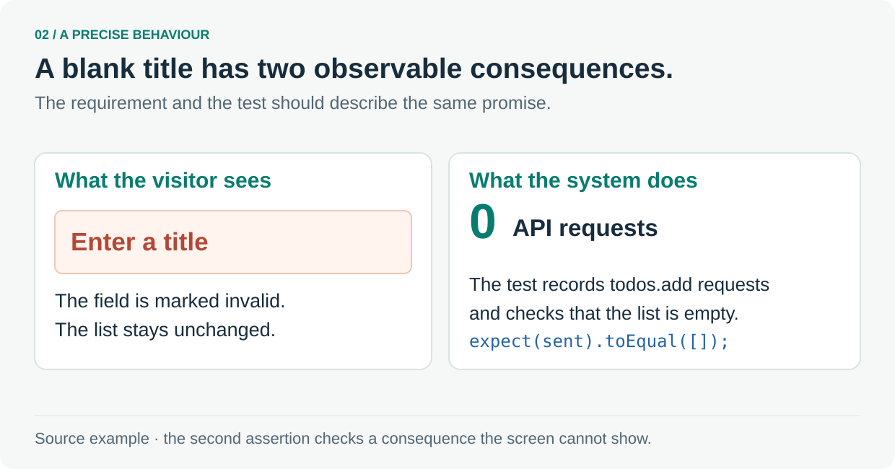

# 2. Make the intended behaviour precise

Follow one small promise from the product requirement to its assertions.



The [to-do requirement](../prd/todos.md) says a blank title must show `Enter a title`, mark the field invalid and send the API zero `todos.add` requests.

The [browser test](../../apps/web/e2e/todos.spec.ts#L291-L301) observes both the page and outgoing requests:

```ts
await expect(page.getByRole('alert')).toHaveText('Enter a title');
expect(sent).toEqual([]);
```

These are two assertions from a larger test. The second assertion checks the unwanted side effect that the visible error alone would miss. The full test starts recording `todos.add` requests before submitting the blank title.

**Follow the source:** [Product requirement](../prd/todos.md) · [Complete browser test](../../apps/web/e2e/todos.spec.ts#L291-L301)

---

[Tour overview](../software-factory-tour.md) · [Previous: What makes a software factory?](01-factory.md) · [Next: Choose checks that catch real mistakes](03-quality.md)
